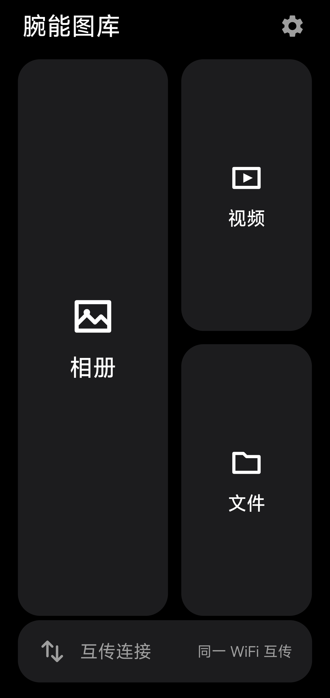
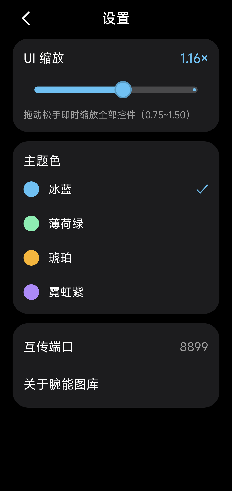
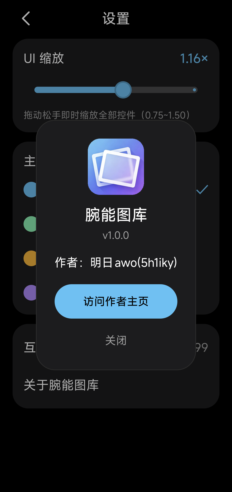
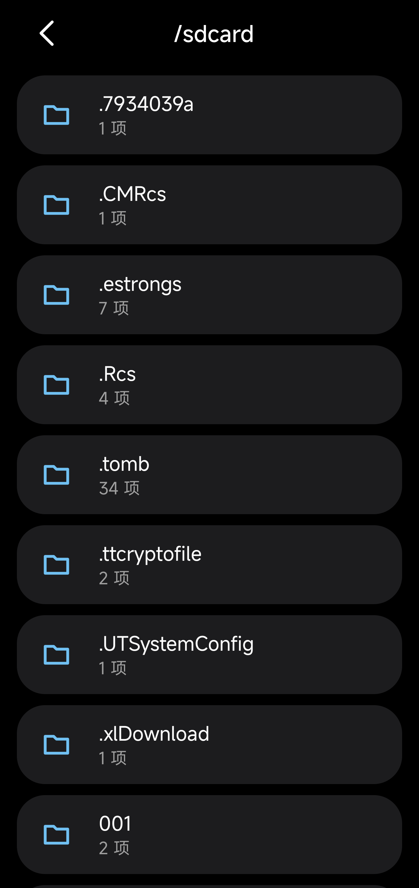

<div align="center">

# 腕能图库 Wristable Gallery

**中文** | [English](README_EN.md)

[](https://github.com/5h1iky/wristable-gallery/actions/workflows/build.yml)
[](https://github.com/5h1iky/wristable-gallery/releases)
[](LICENSE)

**专为安卓手表设计的看图 / 看视频应用**，附带同 WiFi 网页互传与文件浏览器。

纯本地运行，不收集任何数据。

</div>

## 截图

| 首页 | 设置 | 关于 | 互传 | 文件 |
|---|---|---|---|---|
|  |  |  |  |  |

## 功能特性

- **相册**：MediaStore 扫描、按日期分组的 3 列网格（今天/昨天/本周/本月/更早），图片/视频筛选
- **图片查看器**：双指无极缩放、双击放大（带动画）、左右滑翻页、下拉退出、共享元素过渡、信息条自动淡出
- **视频播放器**：TextureView 渲染，无极缩放 / 双击适应⇄填充 / 90° 步进旋转 / 音量亮度手势 / 锁定 / 续播记忆
- **长按菜单**：详情、复制副本、复制到剪贴板、分享、重命名、删除（大批次走系统回收站）
- **WiFi 互传**：手表开 HTTP 服务，手机/电脑浏览器打开地址即可拖拽上传、浏览下载，二维码配对，端口可设
- **文件浏览器**：/sdcard 目录树、任意后缀（后缀徽标）、系统方式打开、删除/重命名/详情
- **设置**：全局 UI 缩放 0.75×~1.5× 即时生效、四色主题（冰蓝/薄荷绿/琥珀/霓虹紫）、关于页

## 兼容性

- Android 7.0+（minSdk 24），targetSdk 36
- 1:1 屏 / dpi186 设计基准，**圆屏方屏双兼容**（圆屏自动安全区内收）
- 纯字节码单 DEX，无任何 `.so` 原生库，32 位 / 64 位手表通吃

## 下载安装

到 [Releases](https://github.com/5h1iky/wristable-gallery/releases) 下载 `Wristable-Gallery-v1.0.0.apk`，用 adb 或手表安装工具安装：

```bash
adb install -r Wristable-Gallery-v1.0.0.apk
```

## 从源码构建

环境：JDK 21（如 Android Studio 自带 JBR）、Android SDK 36。

```bash
git clone https://github.com/5h1iky/wristable-gallery.git
cd wristable-gallery
./gradlew assembleDebug      # 输出 app/build/outputs/apk/debug/app-debug.apk
./gradlew assembleRelease    # 需自行配置 keystore.properties + keystore/ 签名
```

> Windows 使用 `gradlew.bat`。CI（GitHub Actions）在 push / PR 时自动构建 debug 包。

## 技术架构

| 项 | 选型 |
|---|---|
| 语言 / 构建 | Kotlin 1.9.24 + AGP 8.7.0 + Gradle 9.3.1 |
| UI | 传统 View + XML + ViewBinding（省内存、启动快、表端最稳） |
| 图片加载 | Glide 4.16.0 |
| 视频播放 | TextureView + MediaPlayer（自研无极缩放/旋转引擎） |
| 互传 | 自研 ServerSocket/HTTP 零依赖实现 + NsdManager 发现 |
| 二维码 | zxing core 3.5.3 |

## 隐私

- 完全离线可用（仅互传在同一局域网内通信），无统计、无上报、无账号体系
- 所有媒体文件仅在本机读写，不离开你的设备

## 开源协议

[MIT](LICENSE) © 2026 明日awo (5h1iky)
